# Genesis: plant sequencing data preprocessing

Genesis turns public plant sequencing data into model-ready outputs: DAP-seq and bulk and
single-cell ATAC-seq into peaks, signal tracks and QC; RNA-seq into gene counts and tracks; and TSS
mapping (CAGE, TSS-seq, csRNA-seq, RAMPAGE, Smar2C2) into TSS tags and clusters. It runs on Slurm
clusters: `pixi run submit-pipeline` submits the Nextflow manager as a Slurm job, which then submits
each task as its own job. Production runs use NERSC Perlmutter; Stanford Sherlock is supported for
when more compute is needed, and `-p slurm` works on other Slurm clusters (see the [cluster
guide](docs/usage/clusters.md)). Runs on one machine with Docker are for debugging and tests.

Metadata discovery and curation are in
[genesis-curation](https://github.com/kundajelab/genesis-curation). Curated sample sheets for
every workflow are in the [Stanford-Genesis Hugging Face
bucket](https://huggingface.co/buckets/Stanford-Genesis/genesis-curation), and the
[scientific overview](docs/scientific-overview.md) explains what each signal measures.

## Pipeline workflow maps

### DAP-seq workflow



[DAP-seq guide](docs/usage/dapseq-reference.md)

### Bulk ATAC-seq workflow



[Bulk ATAC-seq guide](docs/usage/bulk-atac.md)

### scATAC workflow



[scATAC guide](docs/usage/scatac-seq.md)

From raw 10x reads on NCBI SRA, the same steps follow download, chromap and cell calling:



[From raw 10x reads](docs/usage/scatac-seq.md#from-raw-10x-reads)

### Bulk RNA-seq workflow



[Bulk RNA-seq guide](docs/usage/rna-seq.md)

### TSS mapping workflow



[TSS mapping guide](docs/usage/tss-seq.md)

## Install and check your environment

On a cluster login node (or your own machine, for local runs), install [Pixi](https://pixi.sh/),
then:

```bash
git clone https://github.com/kundajelab/genesis-preprocessing.git
cd genesis-preprocessing
pixi run install-all
```

Runs use the pinned container images in `conf/genesis-images.lock`, with podman-hpc on
Perlmutter, Apptainer on Sherlock and Docker on your own machine.

## Run on a Slurm cluster

Each workflow takes one tab-separated sample sheet (examples below) and an explicitly chosen
reference genome: put the FASTA and annotation named in the sheet in your references folder (each
profile's default is in the [cluster guide](docs/usage/clusters.md); `-R` sets it). Then submit the
run from the checkout:

```bash
pixi run submit-pipeline --workflow atac-seq -n atac-A /path/atac.tsv
# To continue a run that stopped, submit it again with -resume.
pixi run submit-pipeline --workflow atac-seq -n atac-A /path/atac.tsv -resume
```

The command returns once the manager job is queued; its log goes to `~/logs/genesis/`. `--workflow`
is `dap-seq` (the default), `atac-seq`, `scatac-seq`, `scatac-reads`, `rna-seq` or `tss-seq`. Each
run works in `WORKSPACE/RUN_NAME/` and keeps its outputs and traces in `PERSIST_DIR/RUN_NAME/` (on
Perlmutter, `$SCRATCH/workspace` and `$CFS/PROJECT/$USER/runs`), where a resource summary
(`resources.tsv`) is written when it finishes. `pixi run submit-pipeline --help` lists the manager's
options (walltime, QOS, log folder); the [cluster guide](docs/usage/clusters.md) covers references,
images, accounts and QOS. The pipeline checks the whole sheet before starting any task.

Small test sheets for every workflow are in [samplesheets/](samplesheets/README.md).

<a id="sample-sheet"></a>

### DAP-seq

```tsv
sample_id	species	read1_url	read2_url	control_sample	reference_fasta
treatment	Arabidopsis_thaliana	https://example.org/treatment.fastq.gz	-	control	TAIR10.fa.gz
control	Arabidopsis_thaliana	https://example.org/control.fastq.gz	-	-	TAIR10.fa.gz
```

Use `-` for an absent mate or control. Each treatment's control must occur in the same sheet and
match its species, reference and read layout. Treatments receive peaks and peak scores; controls
receive QC and tracks. Peak calling uses MACS3 built from a pinned upstream revision; see
[MACS3 builds and resources](docs/usage/macs3.md). The [DAP-seq guide](docs/usage/dapseq-reference.md)
has the complete sheet rules, reference setup, analysis choices and output definitions.

### Bulk ATAC-seq

One row per paired-end library:

```tsv
sample_id	species	read1_url	read2_url	reference_fasta	reference_genes	organelle_contigs
leaf_rep1	Arabidopsis_thaliana	https://example.org/rep1_1.fastq.gz	https://example.org/rep1_2.fastq.gz	TAIR10.fa.gz	TAIR10.genes.bed	ChrC,ChrM
```

Each library gets fragments, peaks, Tn5 cut-count tracks and QC. The
[ATAC guide](docs/usage/bulk-atac.md) explains the columns, filters and metrics.

### scATAC pseudobulks

From published single-cell fragment files, such as 10x `fragments.tsv.gz`, and a cell list per
library that assigns each barcode to a group (`--workflow scatac-seq`):

```tsv
sample_id	species	fragments_url	cells_url	reference_fasta	reference_genes	organelle_contigs
root_rep1	Arabidopsis_thaliana	https://example.org/rep1.fragments.tsv.gz	https://example.org/rep1.cells.tsv	TAIR10.fa.gz	TAIR10.genes.bed	Mt,Pt
```

When only raw 10x reads are published, `--workflow scatac-reads` downloads them from NCBI SRA,
makes the fragments with chromap and calls cells first; see
[From raw 10x reads](docs/usage/scatac-seq.md#from-raw-10x-reads). Each library's groups become
separate pseudobulks with peaks, Tn5 cut-count tracks and QC. The
[scATAC guide](docs/usage/scatac-seq.md) explains the cell list and metrics.

### RNA-seq

Single- or paired-end libraries, their strandedness, and the reference's annotation as published,
GFF3 or GTF:

```tsv
sample_id	species	read1_url	read2_url	strandedness	reference_fasta	reference_annotation	organelle_contigs
leaf_rep1	Arabidopsis_thaliana	https://example.org/rep1_1.fastq.gz	https://example.org/rep1_2.fastq.gz	reverse	TAIR10.fa.gz	Araport11.gff3	ChrC,ChrM
```

Each library gets STAR alignments, featureCounts gene counts, a CPM track and QC, including
strandedness, rRNA and organelle fractions. The [RNA-seq guide](docs/usage/rna-seq.md) explains
the plant-specific settings.

### TSS mapping

CAGE, nAnT-iCAGE, TSS-seq, oligo-capping, csRNA-seq, RAMPAGE or Smar2C2 libraries, with the fixed
bases to trim from each read's start and the 3' adapter:

```tsv
sample_id	species	read1_url	read2_url	method	trim_5p	adapter_3p	reference_fasta	reference_annotation	organelle_contigs
wt_rep1	Arabidopsis_thaliana	https://example.org/wt1.fastq.gz	-	CAGE	9	TCGTATGCCGTCTTCTGCTTG	TAIR10.fa.gz	Araport11.gff3	ChrC,ChrM
```

Each library gets per-base TSS tags on each strand, paraclu TSS clusters and QC. The
[TSS mapping guide](docs/usage/tss-seq.md) explains the methods, trimming, paired-end layouts and
metrics.

## Run on one machine

Without Slurm, the `local` profile runs every task on the machine itself, with Docker and the same
images, capping each task's CPU and memory requests at what the machine has. Use it to try a sheet
or a change on a small input before submitting; `pixi run pipeline` runs DAP-seq, and
`pipeline-atac`, `pipeline-scatac`, `pipeline-scatac-reads`, `pipeline-rna` and `pipeline-tss` the
others. Pixi runs from the checkout folder, so give absolute paths:

```bash
# Check a sheet and the whole task graph without running the tools.
pixi run pipeline-atac -p local,test -w /tmp/genesis -R /data/references /data/atac.tsv -stub-run
# A real local run.
pixi run pipeline-atac -w /tmp/genesis -n atac-A -R /data/references /data/atac.tsv
```

On a cluster, `-p nersc,test` (or your cluster's profile) does the same stub check through Slurm.
Keep a run's `work/` folder to allow `-resume`.

## Find and interpret your results

Start with the MultiQC report, then inspect the library-level QC and signal
tracks. A successful run means the computation finished; it does not establish
that the data are suitable for every biological analysis. In particular, FastQC
flags need interpretation, and zero peaks can be a valid result.

| Output | What it tells you |
| --- | --- |
| MultiQC and library QC | Read quality, alignment summaries and assay-specific measurements |
| Peaks | Regions enriched under the recorded peak-calling and control settings |
| bigWig tracks | Signal across the reference; check whether the track contains normalized coverage or raw cuts |
| DAP peak scores | Read-end RPM and mean coverage RPKM; these are different statistics |
| ATAC fragments and QC table | Usable paired fragments, FRiP, TSS enrichment and library complexity |
| scATAC pseudobulk QC table | Cells, fragments, insertion FRiP and TSS enrichment per group |
| RNA-seq gene counts and QC table | Unique-alignment gene counts; strandedness, rRNA, organelle and multi-mapping fractions |
| TSS tags, clusters and QC table | Per-base TSS counts on each strand, paraclu clusters, and the fraction of tags near annotated TSSs |
| Provenance and Nextflow reports | Inputs, analysis settings, software identity and execution records |

See the [DAP output definitions](docs/usage/dapseq-reference.md#outputs-and-resources)
and [ATAC outputs](docs/usage/bulk-atac.md#outputs) before comparing measurements
between tools or studies.

## Choose your next task

| I want to… | Start here |
| --- | --- |
| Configure runs on Perlmutter, Sherlock or another Slurm cluster | [Cluster guide](docs/usage/clusters.md) |
| Run DAP-seq or understand its scientific settings | [DAP-seq guide](docs/usage/dapseq-reference.md) |
| Run paired-end bulk ATAC | [Bulk ATAC guide](docs/usage/bulk-atac.md) |
| Make pseudobulks from single-cell ATAC fragments | [scATAC guide](docs/usage/scatac-seq.md) |
| Count genes in plant RNA-seq | [RNA-seq guide](docs/usage/rna-seq.md) |
| Map transcription start sites | [TSS mapping guide](docs/usage/tss-seq.md) |
| Find datasets and curate their metadata | [genesis-curation](https://github.com/kundajelab/genesis-curation) |
| Set up a development environment or contribute | [Contributor guide](docs/development.md) |

The [documentation index](docs/README.md) also links to reference material.

## Troubleshooting

| Problem | First step |
| --- | --- |
| `Missing input TSV` from `pixi run pipeline` | Pixi runs from the checkout folder: give absolute paths, or call `scripts/run-pipeline.sh` directly. |
| A submitted run stops at its walltime | Submit it again with `-resume`; pass `-T` for a longer manager walltime. |
| Images fail to pull on Perlmutter | Pulls run on the login node before submitting; check that Docker Hub is reachable and rerun. |
| Reference or input checksum differs | Check which file changed. Preserve the old run and use a new input/run version. |
| A resumed run repeats some tasks | Check changed inputs, code and reference-cache paths in the Nextflow trace. |
| No peaks or unexpected QC values | Inspect depth, reference, assay settings and control assignment before changing parameters. |
