# Genesis: plant DAP-seq and ATAC-seq processing

Genesis turns plant DAP-seq and paired-end bulk ATAC-seq reads, and published
single-cell ATAC fragments, into peaks, signal tracks and quality-control reports,
and plant RNA-seq reads into gene counts and tracks. It runs on a single server or
through Nextflow on a cluster.

Study management, metadata curation and review, single-cell ATAC model export and
method benchmarks are in [genesis-curation](https://github.com/kundajelab/genesis-curation).

<a id="architecture-and-current-capabilities"></a>

## Scientific purpose and current evidence

Genesis supplies traceable preprocessing and curated data for **plant
sequence-to-function prediction and experimentally testable sequence design**.
The chain is data → declared measurement → model input → downstream test.
It is not a validated plant foundation model or an MPRA platform.

Nextflow runs the supported scientific workflows.

| Implemented capability | Evidence scope | Remaining acceptance |
| --- | --- | --- |
| DAP and bulk ATAC workflows | Real tools on synthetic inputs; selected public subsets | Full-depth biological and task-specific acceptance |

Earlier validation reports and evidence were removed from this repository; see
`validation/` at commit e2e2aa9.

Read the [scientific overview](docs/scientific-overview.md) for measurement
semantics, three evidence-backed observations, and what remains between files,
model training and experimental validation.

## Pipeline workflow maps

### DAP-seq workflow


[View full size](docs/images/genesis_metro_map.svg) · [DAP-seq guide](docs/usage/dapseq-reference.md)

### Bulk ATAC-seq workflow


[View full size](docs/images/genesis_atac_metro_map.svg) · [Bulk ATAC-seq guide](docs/usage/bulk-atac.md)

### scATAC workflow



[View full size](docs/images/genesis_scatac_metro_map.svg) · [scATAC guide](docs/usage/scatac-seq.md)

From raw 10x reads on NCBI SRA, the same steps follow download, chromap and cell calling:



[View full size](docs/images/genesis_scatac_reads_metro_map.svg) · [From raw 10x reads](docs/usage/scatac-seq.md#from-raw-10x-reads)

### Bulk RNA-seq workflow



[View full size](docs/images/genesis_rna_metro_map.svg) · [Bulk RNA-seq guide](docs/usage/rna-seq.md)

### TSS mapping workflow



[View full size](docs/images/genesis_tss_metro_map.svg) · [TSS mapping guide](docs/usage/tss-seq.md)

<a id="install-and-run"></a>
<a id="environments-and-docker-builds"></a>

## Install and check your environment

Install [Pixi](https://pixi.sh/). For the default execution mode, Docker must
already be available to your user. Run:

```bash
git clone https://github.com/kundajelab/genesis-preprocessing.git
cd genesis-preprocessing
pixi run install-all
```

This installs everything the pipelines need: run DAP-seq with `pixi run pipeline`,
bulk ATAC with `pixi run pipeline-atac`, scATAC with `pixi run pipeline-scatac` and
RNA-seq with `pixi run pipeline-rna` (see below).

## Run your first analysis

Run the examples below from the checkout, substituting your input paths. Both
pipelines need an explicitly selected reference genome; Genesis does not choose
or download an assembly for you.

<a id="sample-sheet"></a>

### DAP-seq

Prepare a tab-separated sample sheet with this exact header:

```tsv
sample_id	species	read1_url	read2_url	control_sample	reference_fasta
treatment	Arabidopsis_thaliana	https://example.org/treatment.fastq.gz	-	control	TAIR10.fa.gz
control	Arabidopsis_thaliana	https://example.org/control.fastq.gz	-	-	TAIR10.fa.gz
```

Replace the example URLs. Use `-` for an absent mate or control. Put the named
gzipped FASTA in your reference directory. Each treatment's control must occur
in the same sheet and match its species, reference and read layout.

Run the pipeline from the checkout with `pixi run pipeline`. Pixi runs it from the
checkout folder, so give the sheet and other paths as absolute paths:

```bash
pixi run pipeline -w /scratch/genesis -n study-A /data/dap.tsv --references /data/references
# Continue the same analysis after an interruption.
pixi run pipeline -w /scratch/genesis -n study-A /data/dap.tsv --references /data/references -resume
```

Alternatively, call the script directly; it uses the checkout's Pixi environment
itself, and relative paths resolve from your current folder:

```bash
/path/to/genesis-preprocessing/scripts/run-pipeline.sh -w /scratch/genesis -n study-A \
  dap.tsv --references /data/references
```

`pixi run pipeline --help` lists the options. Choose a profile with `-p` (for
example `-p local,conda` or `-p sherlock,apptainer`); the default is `local,docker`,
and a cluster is always selected explicitly. The pipeline checks the whole sheet
before starting any task.

Results appear in `/scratch/genesis/study-A/output/`, grouped by species and
sample. Treatments receive peaks and peak scores; controls receive QC and tracks.
Keep the run's `work/` directory to allow resume.

Peak calling uses MACS3 built from a pinned upstream revision; see
[MACS3 builds and resources](docs/usage/macs3.md).

Read the [DAP-seq guide](docs/usage/dapseq-reference.md) for complete sample-sheet
rules, reference setup, analysis choices and output definitions.

### Bulk ATAC-seq

Bulk ATAC uses the same launcher, references folder and workspace as DAP-seq. Its
sample sheet has one row per paired-end library:

```tsv
sample_id	species	read1_url	read2_url	reference_fasta	reference_genes	organelle_contigs
leaf_rep1	Arabidopsis_thaliana	https://example.org/rep1_1.fastq.gz	https://example.org/rep1_2.fastq.gz	TAIR10.fa.gz	TAIR10.genes.bed	ChrC,ChrM
```

```bash
pixi run pipeline-atac -w /scratch/genesis -n atac-A /data/atac.tsv --references /data/references
```

Results appear in `/scratch/genesis/atac-A/output/`: fragments, peaks, Tn5 cut-count
tracks and QC for each library. The [ATAC guide](docs/usage/bulk-atac.md) explains
the columns, filters and metrics.

### scATAC pseudobulks

scATAC starts from published single-cell fragment files, such as 10x
`fragments.tsv.gz`, and a cell list per library that assigns each barcode to a group:

```tsv
sample_id	species	fragments_url	cells_url	reference_fasta	reference_genes	organelle_contigs
root_rep1	Arabidopsis_thaliana	https://example.org/rep1.fragments.tsv.gz	https://example.org/rep1.cells.tsv	TAIR10.fa.gz	TAIR10.genes.bed	Mt,Pt
```

```bash
pixi run pipeline-scatac -w /scratch/genesis -n scatac-A /data/scatac.tsv --references /data/references
```

Each library's groups become separate pseudobulks with peaks, Tn5 cut-count tracks and
QC. The [scATAC guide](docs/usage/scatac-seq.md) explains the cell list and metrics.

When only raw 10x reads are published, `pixi run pipeline-scatac-reads` downloads them from
NCBI SRA, makes the fragments with chromap and calls cells, then runs the same steps; see
[From raw 10x reads](docs/usage/scatac-seq.md#from-raw-10x-reads).

### RNA-seq

RNA-seq takes single- or paired-end libraries, their strandedness, and the reference's
annotation as published, GFF3 or GTF:

```tsv
sample_id	species	read1_url	read2_url	strandedness	reference_fasta	reference_annotation	organelle_contigs
leaf_rep1	Arabidopsis_thaliana	https://example.org/rep1_1.fastq.gz	https://example.org/rep1_2.fastq.gz	reverse	TAIR10.fa.gz	Araport11.gff3	ChrC,ChrM
```

```bash
pixi run pipeline-rna -w /scratch/genesis -n rna-A /data/rna.tsv --references /data/references
```

Each library gets STAR alignments, featureCounts gene counts, a CPM track and QC,
including strandedness, rRNA and organelle fractions. The
[RNA-seq guide](docs/usage/rna-seq.md) explains the plant-specific settings.

<a id="analysis-choices"></a>
<a id="outputs-and-resources"></a>


### TSS mapping

TSS mapping takes single-read CAGE, TSS-seq or csRNA-seq libraries, with the fixed
bases to trim from each read's start and the 3' adapter:

```tsv
sample_id	species	read1_url	method	trim_5p	adapter_3p	reference_fasta	reference_annotation	organelle_contigs
wt_rep1	Arabidopsis_thaliana	https://example.org/wt1.fastq.gz	CAGE	9	TCGTATGCCGTCTTCTGCTTG	TAIR10.fa.gz	Araport11.gff3	ChrC,ChrM
```

```bash
pixi run pipeline-tss -w /scratch/genesis -n tss-A /data/tss.tsv --references /data/references
```

Each library gets per-base TSS tags on each strand, paraclu TSS clusters and QC. The
[TSS mapping guide](docs/usage/tss-seq.md) explains the methods, trimming and metrics.
## Find and interpret your results

Start with the MultiQC report, then inspect the library-level QC and signal
tracks. A successful run means the computation finished; it does not establish
that the data are suitable for every biological analysis. In particular, FastQC
flags need interpretation, and zero peaks can be a valid result.

| Output | What it tells you |
| --- | --- |
| MultiQC and library QC | Read quality, alignment summaries and assay-specific measurements |
| Peaks | Regions enriched under the recorded peak-calling and control settings |
| bigWig tracks | Signal across the reference; check whether the track contains normalized coverage or raw cuts |
| DAP peak scores | Read-end RPM and mean coverage RPKM; these are different statistics |
| ATAC fragments and QC table | Usable paired fragments, FRiP, TSS enrichment and library complexity |
| scATAC pseudobulk QC table | Cells, fragments, insertion FRiP and TSS enrichment per group |
| RNA-seq gene counts and QC table | Unique-alignment gene counts; strandedness, rRNA, organelle and multi-mapping fractions |
| Provenance and Nextflow reports | Inputs, analysis settings, software identity and execution records |

See the [DAP output definitions](docs/usage/dapseq-reference.md#outputs-and-resources)
and [ATAC outputs](docs/usage/bulk-atac.md#outputs) before comparing measurements
between tools or studies.

<a id="reference-compatibility-and-development"></a>

## Choose your next task

| I want to… | Start here |
| --- | --- |
| Run DAP-seq or understand its scientific settings | [DAP-seq guide](docs/usage/dapseq-reference.md) |
| Run paired-end bulk ATAC | [Bulk ATAC guide](docs/usage/bulk-atac.md) |
| Make pseudobulks from single-cell ATAC fragments | [scATAC guide](docs/usage/scatac-seq.md) |
| Count genes in plant RNA-seq | [RNA-seq guide](docs/usage/rna-seq.md) |
| Map transcription start sites | [TSS mapping guide](docs/usage/tss-seq.md) |
| Manage studies, curate metadata or export single-cell ATAC for models | [genesis-curation](https://github.com/kundajelab/genesis-curation) |
| Compare processing methods | [Benchmark guide](https://github.com/kundajelab/genesis-curation/blob/main/benchmarks/README.md) |
| Set up a development environment or contribute | [Contributor guide](docs/development.md) |

The [documentation index](docs/README.md) also links to reference material.

<a id="verification"></a>

## Benchmarks and tool choices

The [benchmark
guide](https://github.com/kundajelab/genesis-curation/blob/main/benchmarks/README.md)
in genesis-curation has the experiment matrix, metric definitions and reproduction
commands. It distinguishes package comparisons from parameter sensitivity and software
tests. A higher mapping rate or more peaks alone is not evidence that one method is
better.

Earlier comparisons covered 64 Arabidopsis method/depth cases with independent TF
motif evidence, biological ATAC replicates, reference assemblies and annotation
releases. They did not establish a better replacement for the BWA-MEM2/MACS3
defaults across assays. Optimized MACS3 builds were compared for speed, memory use
and output equivalence at matched CPU allocations, and complete workflows were
scored against nf-core ATAC with common metric definitions.

## Troubleshooting

| Problem | First step |
| --- | --- |
| `Missing input TSV` from `pixi run pipeline` | Pixi runs from the checkout folder: give absolute paths, or call `scripts/run-pipeline.sh` directly. |
| Docker or Nextflow is unavailable | Rerun `pixi run install-all` and check that Docker works for your user. |
| Reference or input checksum differs | Check which file changed. Preserve the old run and use a new input/run version. |
| A resumed run repeats some tasks | Check changed inputs, code and reference-cache paths in the Nextflow trace. |
| No peaks or unexpected QC values | Inspect depth, reference, assay settings and control assignment before changing parameters. |
