# Genesis: plant DAP-seq and ATAC-seq processing

Genesis turns plant DAP-seq and paired-end bulk ATAC-seq reads into peaks, signal
tracks and quality-control reports. It runs on a single server or through
Nextflow on a cluster. You can also organize results in a local catalog, review
metadata and QC, and export a selected dataset collection.

Start with the standalone pipeline for your assay. Study management, the catalog
and AI assistance are optional.

<a id="architecture-and-current-capabilities"></a>

## Scientific purpose and current evidence

Genesis supplies traceable preprocessing and curated data for **plant
sequence-to-function prediction and experimentally testable sequence design**.
The chain is data → declared measurement → model input → downstream test.
It is not a validated plant foundation model or an MPRA platform.

Nextflow runs the supported scientific workflows. Optional LLMs assist metadata
curation and explanation; they do not grant scientific approval.

| Implemented capability | Evidence scope | Evidence revision/source | Remaining acceptance |
| --- | --- | --- | --- |
| DAP and bulk ATAC workflows | Real tools on synthetic inputs; selected public subsets | [Study acceptance](validation/reports/real-study-validation.md); [public comparisons](validation/reports/expanded-plant-comparison.md), archived in `b9d0cf7` | Full-depth biological and task-specific acceptance |
| scATAC fragment ingestion, pseudobulks and model exports | Synthetic contracts and real tools/loaders on synthetic inputs | [scATAC record](validation/reports/scatac-delivery-validation.md), dated 2026-10-10 with baseline and implementation revisions | Reviewed real-data bundles, plant bias evidence and exact-bundle loader acceptance; no scATAC FASTQ processing |
| Read-only model-bundle inspection | Bounded artifact, convention and context-window checks | [Inspection guide](docs/usage/scatac-model-handoff.md#inspect-a-bundle); report records inspector and bundle hashes | Structural checks do not approve training |
| Registry/review and optional workers/AI services | Offline/local-worker fixtures and mock HTTP/lifecycle tests | [Validation records](validation/README.md), each with its own tested revision | Site-specific SSH/scheduler/API/GPU acceptance and biological curation accuracy |

Read the [scientific overview](docs/scientific-overview.md) for measurement
semantics, three evidence-backed observations, and what remains between files,
model training and experimental validation. Use the
[offline inspection example](docs/usage/scatac-model-handoff.md#offline-inspection-example)
to examine a clearly labelled synthetic bundle.

## Pipeline workflow maps

### DAP-seq workflow



[View full size](docs/images/genesis_metro_map.svg) · [DAP-seq guide](docs/usage/dapseq-reference.md)

### Bulk ATAC-seq workflow



[View full size](docs/images/genesis_atac_metro_map.svg) · [Bulk ATAC-seq guide](docs/usage/bulk-atac.md)

<a id="install-and-run"></a>
<a id="environments-and-docker-builds"></a>

## Install and check your environment

Install [Pixi](https://pixi.sh/). For the default execution mode, Docker must
already be available to your user. Run:

```bash
git clone https://github.com/kundajelab/genesis-preprocessing.git
cd genesis-preprocessing
pixi run install-all
```

This installs everything the DAP-seq pipeline needs; run it with `pixi run pipeline`
(see [DAP-seq](#dap-seq) below).

The bulk ATAC, validation and curation commands below use the `genesis` command.
To install it, run `pixi run install-all --install-cli` instead, keep
`~/.local/bin` on your PATH (`export PATH="$HOME/.local/bin:$PATH"`), and check it
with `genesis doctor`. The installer links `genesis` to this checkout; keep the
checkout in place, or add `--bin-dir /your/bin` to use another command directory.
See [installation and upgrades](docs/development.md#command-installation-and-maintenance)
for moving a checkout, using a Python wheel or removing the command.

## Run your first analysis

Run the examples below from the checkout, substituting your input paths. Both
pipelines need an explicitly selected reference genome; Genesis does not choose
or download an assembly for you.

<a id="sample-sheet"></a>

### DAP-seq

Prepare a tab-separated sample sheet with this exact header:

```tsv
sample_id	species	read1_url	read2_url	control_sample	reference_fasta
treatment	Arabidopsis_thaliana	https://example.org/treatment.fastq.gz	-	control	TAIR10.fa.gz
control	Arabidopsis_thaliana	https://example.org/control.fastq.gz	-	-	TAIR10.fa.gz
```

Replace the example URLs. Use `-` for an absent mate or control. Put the named
gzipped FASTA in your reference directory. Each treatment's control must occur
in the same sheet and match its species, reference and read layout.

Run the pipeline from the checkout with `pixi run pipeline`. Pixi runs it from the
checkout folder, so give the sheet and other paths as absolute paths:

```bash
pixi run pipeline -w /scratch/genesis -n study-A /data/dap.tsv --references /data/references
# Continue the same analysis after an interruption.
pixi run pipeline -w /scratch/genesis -n study-A /data/dap.tsv --references /data/references -resume
```

Alternatively, call the script directly; it uses the checkout's Pixi environment
itself, and relative paths resolve from your current folder:

```bash
/path/to/genesis-preprocessing/scripts/run-pipeline.sh -w /scratch/genesis -n study-A \
  dap.tsv --references /data/references
```

`pixi run pipeline --help` lists the options. Choose a profile with `-p` (for
example `-p local,conda` or `-p sherlock,apptainer`); the default is `local,docker`,
and a cluster is always selected explicitly. The pipeline checks the whole sheet
before starting any task.

Results appear in `/scratch/genesis/study-A/output/`, grouped by species and
sample. Treatments receive peaks and peak scores; controls receive QC and tracks.
Keep the run's `work/` directory to allow resume.

Peak calling uses MACS3 built from a pinned upstream revision; see
[MACS3 builds and resources](docs/usage/macs3.md).

Read the [DAP-seq guide](docs/usage/dapseq-reference.md) for complete sample-sheet
rules, reference setup, analysis choices and output definitions.

### Bulk ATAC-seq

Prepare one row per paired-end technical lane and a reference registry containing
the FASTA, annotation-derived TSS positions, organellar contigs and checksums.
The [ATAC guide](docs/usage/bulk-atac.md) explains the columns and reference fields.

```bash
genesis validate inputs atac.tsv --assay bulk-ATAC --references references.json
genesis pipeline-atac atac.tsv --references references.json --outdir /scratch/atac-run
genesis pipeline-atac atac.tsv --references references.json --outdir /scratch/atac-run --resume
```

Results appear under `/scratch/atac-run/output/`. Each library has QC reports,
fragments, Tn5 cut-count tracks and peaks. Technical lanes are combined within a
library; biological replicates remain separate. Choose MAPQ, duplicate and adapter
policies in the sample sheet before running.

<a id="analysis-choices"></a>
<a id="outputs-and-resources"></a>

## Find and interpret your results

Start with the MultiQC report, then inspect the library-level QC and signal
tracks. A successful run means the computation finished; it does not establish
that the data are suitable for every biological analysis. In particular, FastQC
flags need interpretation, and zero peaks can be a valid result.

| Output | What it tells you |
| --- | --- |
| MultiQC and library QC | Read quality, alignment summaries and assay-specific measurements |
| Peaks | Regions enriched under the recorded peak-calling and control settings |
| bigWig tracks | Signal across the reference; check whether the track contains normalized coverage or raw cuts |
| DAP peak scores | Read-end RPM and mean coverage RPKM; these are different statistics |
| ATAC fragments and enrichment metrics | Usable paired fragments, fragment FRiP and TSS enrichment |
| Provenance and Nextflow reports | Inputs, analysis settings, software identity and execution records |

See the [DAP output definitions](docs/usage/dapseq-reference.md#outputs-and-resources)
and [ATAC outputs](docs/usage/bulk-atac.md#outputs) before comparing measurements
between tools or studies.

<a id="reference-compatibility-and-development"></a>

## Choose your next task

| I want to… | Start here |
| --- | --- |
| Run DAP-seq or understand its scientific settings | [DAP-seq guide](docs/usage/dapseq-reference.md) |
| Run paired-end bulk ATAC | [Bulk ATAC guide](docs/usage/bulk-atac.md) |
| Run on a cluster or independent servers | [Execution guide](docs/usage/execution.md) |
| Manage a study from inputs through reviewed export | [Study workflow](docs/usage/studies.md) |
| Validate results, search a catalog or review QC | [Curation guide](docs/usage/curation.md) |
| Import single-cell fragments and build pseudobulks | [Single-cell ATAC guide](docs/usage/scatac.md) |
| Prepare scATAC outputs for model loaders | [Model handoff](docs/usage/scatac-model-handoff.md) |
| Propose metadata or explain a failure with an LLM | [AI providers](docs/usage/ai-providers.md) |
| Host a private model on an existing node | [Model services](docs/usage/llm-deployment.md) |
| Compare processing methods and inspect benchmark evidence | [Benchmarks](benchmarks/README.md) |
| Set up a development environment or contribute | [Contributor guide](docs/development.md) |

The [documentation index](docs/README.md) also links to reference material and
validation records. Core processing, catalog queries and manual review work
without AI, a GPU or an API account.

<a id="verification"></a>

## Benchmarks and tool choices

Use [the benchmark guide](benchmarks/README.md) for the experiment matrix, metric
definitions, results and reproduction commands. It distinguishes package comparisons
from parameter sensitivity and software tests. A higher mapping rate or more peaks
alone is not evidence that one method is better.

The [plant comparison report](validation/reports/expanded-plant-comparison.md)
contains 64 completed Arabidopsis method/depth cases, independent TF motif evidence,
biological ATAC replicate measurements, and comparisons of reference assemblies
and annotation releases. The report records the evidence available at its stated
revision; its A. lyrata, sorghum and maize entries are not evidence of completed
comparisons or currently running jobs. The current evidence does not establish a better
replacement for the BWA-MEM2/MACS3 defaults across assays.
The [optimized MACS3 comparison](validation/reports/macs3-optimization.md) measures
caller speed, memory use and output equivalence at matched CPU allocations.
The [complete-workflow comparison](validation/reports/pipeline-method-comparison.md)
scores Genesis and nf-core ATAC using common metric definitions.

## Troubleshooting

| Problem | First step |
| --- | --- |
| `Missing input TSV` from `pixi run pipeline` | Pixi runs from the checkout folder: give absolute paths, or call `scripts/run-pipeline.sh` directly. |
| `genesis: command not found` | Complete installation with `--install-cli` and check your PATH. |
| Docker or Nextflow is unavailable | Run `genesis doctor`; check the selected runtime and installation. |
| Reference or input checksum differs | Check which file changed. Preserve the old run and use a new input/run version. |
| A resumed run repeats some tasks | Check changed inputs, code and reference-cache paths in the Nextflow trace. |
| No peaks or unexpected QC values | Inspect depth, reference, assay settings and control assignment before changing parameters. |
| A reviewed export is empty | Read its exclusions; validation or current review decisions may be missing. |
| A worker is unreachable | Inspect worker status and reconnect before authorizing another attempt. |
