# DAP-seq reference guide

Genesis is a Nextflow DSL2 pipeline for single-end and paired-end plant DAP-seq.
It downloads libraries, derives reference indexes and chromosome sizes, aligns
with bwa-mem2, inspects raw reads with FastQC, runs SPP and alignment QC, generates deepTools coverage tracks,
calls MACS3 peaks against each treatment's assigned control, and quantifies peaks.



[Static workflow map](../../docs/images/genesis_metro_map.svg) ·
[Architecture and implementation status](../../docs/images/genesis_architecture_metro_map.svg) ·
[Diagram source and interpretation](../../docs/diagrams/README.md)

| Sample sheet | Layout | Libraries | Treatments |
| --- | --- | ---: | ---: |
| `01-Arabidopsis_thaliana-GSE60141.tsv` | SE | 936 | 934 |
| `15-Arabidopsis_lyrata-PRJNA1177479.tsv` | PE | 405 | 378 |
| `16-Arabidopsis_thaliana-PRJNA1177481.tsv` | PE | 800 | 748 |
| `24-Sorghum_bicolor-PRJNA1177471.tsv` | PE | 142 | 134 |

These six-column sheets contain the source sample IDs, read URLs and assigned
controls. Use one sheet per analysis.

## Install and run

Install [Pixi](https://pixi.sh/), then install the project and its Python tools:

```bash
pixi run install-all --install-cli
export PATH="$HOME/.local/bin:$PATH"
```

Place each sheet's gzipped reference FASTA under `references/`, using the exact
basename in `reference_fasta`. Reference genomes are not downloaded automatically.
The `GET_REFERENCES` subworkflow (`modules/get_references.nf`) builds each
reference's chromosome sizes and bwa-mem2 index and publishes them beside the FASTA,
with `<fasta>.sha256`. Its first line is the SHA-256 of the compressed FASTA (in
`sha256sum` format); each further line records a product's size in bytes. Every run,
including resume, rehashes each FASTA. It reuses `<id>.chrom.sizes` and
`<id>.bwa-mem2/` only when the hash matches and every product is present at its
recorded size; otherwise it rebuilds both and saves a new record. Replacing or
re-compressing a FASTA, or a replaced or partly copied product, therefore rebuilds
automatically. Stub runs (`-stub-run`) never publish into the references folder. Distinct FASTA basenames
must not collapse to the same reference ID after removing their suffix. The first
resume after generating references can rerun downstream tasks as inputs move to
published paths; subsequent resumes reuse computation.

Run exactly one sheet per invocation. These examples run from the checkout, where
the bundled sheets live; `pixi run pipeline` always runs from the checkout folder, so
give sheets elsewhere as absolute paths:

```bash
# Show wrapper options.
pixi run pipeline --help

# Run test data with default profile: local Docker.
pixi run pipeline test-Sorghum_bicolor-PRJNA1177471.tsv

# Local execution with micromamba/conda environments.
pixi run pipeline -p local,conda 15-Arabidopsis_lyrata-PRJNA1177479.tsv

# Continue a previous run using Nextflow's task cache.
pixi run pipeline 15-Arabidopsis_lyrata-PRJNA1177479.tsv -resume

# Submit tasks from Sherlock using accessible container images.
pixi run pipeline -p sherlock,apptainer 15-Arabidopsis_lyrata-PRJNA1177479.tsv
```

You can also call `scripts/run-pipeline.sh` directly, from any folder; relative paths
then resolve from your current folder. Either way, Nextflow runs in the checkout's
Pixi environment, so it can find micromamba. Choose the profile with `-p`/`--profile`
rather than Nextflow's `-profile`, which the script already sets. Without `-p`,
`scripts/get-default-profile.sh` always chooses `local,docker`. Cluster execution is
selected explicitly.
Choose an executor and a software environment together. `sherlock` uses SLURM and the
`normal` queue; select another queue with `--slurm_queue`. Locally built images
must be published with approval, or made available on the cluster, before
Sherlock's Apptainer can use them. Cluster work, cache, reference, and output
paths must be visible to compute nodes and writable by the user.

Each run lives in `WORKSPACE/RUN_NAME/`, where `RUN_NAME` defaults to the sheet's
basename without `.tsv` (override with `-n`/`--run-name`). The default workspace,
from `scripts/get-default-workspace.sh`, is `$SCRATCH/workspace` when `$SCRATCH`
is set and `workspace/` in this repository otherwise; override it with
`-w`/`--workspace`. A run folder contains:

- `work/`: the Nextflow work directory.
- `output/`: published results.
- `trace/`: timestamped execution report, timeline, trace, and DAG files.
- `.nextflow.log` and `.nextflow/`: the wrapper launches Nextflow from the run
  folder, so `-resume` uses that run's history.

Use `--references /absolute/path` to choose the reference location (default
`references/` in this repository). Relative paths in Nextflow arguments resolve
against the run folder. Nextflow retains intermediate FASTQs and BAMs under its
work directory for caching; retain it for `-resume` and clean it only when those
intermediates are no longer needed. Task scripts run with `bash -euxo pipefail`,
so each task's `.command.log` records the commands it ran.

```bash
# Path to the most recent execution report (optional argument: WORKSPACE).
pixi run get-latest-report
# Follow a task's log by the hash Nextflow prints, hiding `set -x` lines.
pixi run watch-log ab/123456
```

## Sample sheet

The header and column order are fixed:

```tsv
sample_id	species	read1_url	read2_url	control_sample	reference_fasta
treatment	Arabidopsis_thaliana	https://example.org/treatment.fastq.gz	-	control	TAIR10.fa.gz
control	Arabidopsis_thaliana	https://example.org/control.fastq.gz	-	-	TAIR10.fa.gz
```

Use `-` for an absent mate or control. A mate URL selects paired-end processing.
Sample IDs must be unique within the sheet. Every assigned control must appear
in the same sheet, have `control_sample = -`, and match the treatment's species,
reference, and layout. Controls receive alignment, QC, and tracks; treatments
also receive peaks and quantification. Multiple treatments can share a control.
The whole sheet is validated before any task starts: nf-schema checks it against
`assets/schema_input.json` (required values, patterns, unique sample IDs), then
`workflows/dap-seq.nf` checks the exact header, the reference FASTAs, reference IDs and control
assignments.

For interspecies DAP, distinguish the TF-source organism from the organism whose
DNA was assayed. The alignment reference must describe that DNA. Preserve the
original sheet labels, and record the separate biological identities in the
[curation metadata](curation.md); do not infer both from a single species label.

Reference names are gzipped FASTA basenames ending in `.fa.gz`, `.fasta.gz`, or
`.fna.gz`. Identifiers and filenames may contain letters, digits, underscores,
periods, and hyphens, with a letter, digit, or underscore first. Read URLs must
be HTTP or HTTPS. Reads are downloaded in batches of `--download_batch_size`
samples (default 8), one batch at a time; mates with matching basenames are fine.

## Analysis choices

The main workflow uses bwa-mem2 for alignment. The Bowtie 1 comparison modules in
`modules/` are not imported or run by this workflow.

Main and first-read QC alignments use **full reads**; only SPP's input is cut
(see below). Read length is inferred
from up to the first 100 reads per mate and recorded as metadata; it is not a
trimming instruction. Inspected reads must be nonempty, structurally valid, and
uniform in length across mates. Remote reads are fetched with parallel aria2c
connections and fully decompressed with bgzip, which checks gzip integrity; first-read
line counts must be divisible by four, and paired FASTQs must have equal line
counts. Genome size is the sum of chromosome sizes derived from the FASTA.

The main bwa-mem2 BAM retains primary mapped alignments, including **MAPQ 0**.
`samtools view -F 2308` excludes unmapped, secondary, and supplementary records.
There is no MAPQ threshold, NH weighting, or separate deduplication step in the
bwa-mem2 alignment. QC aligns full first reads as an unpaired library, used for
first-read statistics and tracks. A third alignment, for SPP only, uses first
reads cut to their first 50 bases (`--spp_read_length`). Each sample's alignment
provenance records the bwa-mem2 version, layout, read length, flag exclusion,
options, and the QC and SPP read policies.

The currently pinned alignment image contains BWA-MEM2 **2.3**, although its
executable banner reports `2.2.1`. Use the image digest, package metadata and
executable hashes to identify that build. The
[benchmark identity check](../../validation/reports/pipeline-method-comparison.md#production-identity-correction)
records the discrepancy.

BWA defaults are `-K 10000000 -k 19 -c 10000 -T 30`. Override them with
`--bwa_batch_size`, `--bwa_seed_length`, `--bwa_max_seed_occurrences`, and
`--bwa_score_threshold`; each must be a positive integer.
Parameters are validated against `nextflow_schema.json` (nf-schema) before any
task runs, and parameters that differ from the defaults are logged at startup.

SPP uses the unmodified, vendored upstream `run_spp.R` revision
[`6984a713aba0218b76bacc63f2fb5087425fd6a3`](https://github.com/kundajelab/phantompeakqualtools/blob/6984a713aba0218b76bacc63f2fb5087425fd6a3/run_spp.R),
with shift range `-s=-0:2:400`, GNU awk, and first reads cut to 50 bases
before alignment, as in ENCODE's cross-correlation QC. With full-length reads as
long as the fragments (e.g. 151-base reads of ~140-base DAP-seq fragments), the
read-length phantom peak hides the fragment peak and SPP cannot estimate a
fragment length. Cutting before alignment, not after, puts the phantom peak at
the cut length, so NSC and RSC keep their usual meaning. If SPP still finds no
fragment peak, QC records a row with `NA` estimates instead of failing.
The provenance and differences from the historical Sherlock script are explained
in [vendor/phantompeakqualtools/README.md](../../vendor/phantompeakqualtools/README.md).
SPP scores can differ from the old workflow because of the aligner, read lengths,
and upstream correlation-baseline changes.

MACS3 uses `BAM` for SE and `BAMPE` for PE, the assigned control, inferred genome
size, and its remaining defaults. In particular, MACS3's default `--keep-dup=1`
limits identical-position/strand SE tags or identical PE fragments during peak
calling. It still reads alignments carrying the BAM duplicate flag; marking a
BAM is not the same as excluding those records. Thus retaining duplicates in the
alignment BAM does not mean peak calling retains every duplicate observation.

Tracks and primary-weighted quantification use the retained BAM, without a
separate duplicate filter; paired read ends count independently in quantification.
Consequently, excluding duplicate records can change coverage and quantification
even when peak calls remain unchanged. These behaviors describe the current
implementation, not a recommendation to remove duplicates from DAP-seq libraries.

deepTools produces total and strand-specific
CPM coverage and strand-specific 5-prime counts at one-base resolution. PE
libraries additionally receive first-read tracks. Tracks have no MAPQ filter.
Strand CPM uses the total alignment count as its shared scaling denominator.

Peak RPM counts overlapping retained primary **read ends**, dividing by all
retained mapped read ends and multiplying by one million; paired ends count
independently. Mean RPKM is the length-weighted average of deepTools' RPKM
bedGraph over each peak, including uncovered bases as zero. Both score files
preserve the narrowPeak rows and append one value. Mean coverage RPKM is a
coverage statistic and differs from read-end RPM divided by peak length in kb.
A single `QUANTIFY` task reads the BAM with pysam and the bedGraph directly,
with no SAM or BED intermediates; overlaps follow `bedtools intersect` (at least
one shared base). The standalone `genesis-tools peak-rpm` command also supports
explicit NH fractional weighting when input alignments have valid NH tags.

## Outputs and resources

Published results live at `WORKSPACE/RUN_NAME/output/<species>/<sample_id>/`:

- FASTQ line counts, metadata, and alignment provenance TSVs.
- Raw-read FastQC HTML/ZIP pairs and version files in `qc/fastqc/`, named
  `<sample_id>.read1_fastqc.*` (SE and PE) and `<sample_id>.read2_fastqc.*` (PE).
- SPP TSV/PDF, samtools flagstat, idxstats, and alignment statistics; PE insert-length distributions.
- CPM and 5-prime count bigWigs, including PE first-read tracks.
- Treatment MACS3 outputs, including gzipped narrowPeak files.
- Treatment `.peaks.RPM.tsv` and `.peaks.mean_RPKM.tsv` scores.

A single run-level aggregate is published at
`WORKSPACE/RUN_NAME/output/multiqc/multiqc_report.html`, with the complete
`multiqc_data/` directory beside it. MultiQC 1.35 consumes FastQC ZIPs, samtools
flagstat, both main/read1 samtools stats, idxstats, and Genesis metadata directly
from completed workflow channels. Full report identifiers are preserved: main and
read1 statistics, and R1/R2 FastQC, never share an entry. The aggregation fails if
any required parser or expected sample is absent, even if MultiQC exits zero.

The Genesis table and header include sample/control associations, species,
reference ID, run name, Git SHA, source-tree status and pipeline version. Read SPP
results in each library's TSV/PDF files. They are not aggregated into MultiQC
because its native phantompeakqualtools parser cannot handle Genesis's valid `NA`
fallback rows. Missing optional SPP/insert-size companion files do not prevent
aggregation; PE insert-size metrics are included in samtools stats.

`multiqc_data/` retains native JSON/parquet, source records, logs and configuration,
plus `genesis_{fastqc,stats,flagstat,idxstats}.json` and `genesis_provenance.json`.
MultiQC's idxstats parser exports mapped counts and reference lengths; original
per-library TSVs also retain unmapped counts. No biological thresholds are imposed.
The committed `multiqc_config.yaml` disables broad name cleaning and keeps
positive-count contigs visible. Three renderer-only fields (gzip timestamp, UUID,
and embedded creation date) are canonicalized for reproducible HTML; native JSON
retains generation metadata. A stable resume caches the complete report/data set.

### Run records

Each run writes two records to its output folder when it starts:

- `dap-images.lock`: a copy of `conf/dap-images.lock`, the container image pins
  (by digest) used by container profiles. Conda runs use the locked
  `environments/*.yaml` instead.
- `git-status.txt`: the pipeline checkout's branch and commit, the container
  engine (`docker`, `apptainer`, … or `none` for Conda), and every uncommitted or
  untracked file reported by `git status --porcelain` (`dirty files: none` for a
  clean checkout).

Curation reads both files. A run's provenance is complete only when it ran from a
clean checkout with a container engine, using images that are all pinned by
`@sha256` digest; otherwise the imported manifests list the reasons, and their
datasets do not pass full structural validation.

Per-sample `*.alignment.tsv` files record the aligner version and options, and
the MultiQC report's provenance records the run name, Git commit and clean/dirty
status. Use the run's Nextflow traces for measured task runtime and memory.

Curation derives completeness from these records: a run from a clean checkout,
with a container engine and digest-pinned images, allows full validation and the
default reviewed export. Dirty or unknown checkouts, Conda runs and mutable images
can be inspected but are incomplete.

Full byte/format scans, scientific QC review and eligibility review are separate
from successful execution.
See the [curation guide](curation.md#validate-existing-inputs-and-published-runs) and
[study acceptance recipe](studies.md#real-tool-acceptance-on-synthetic-inputs).

**FASTQs, BAMs, BAM indexes, and bedGraphs are excluded from published results.** Derived reference files
are published separately under the reference directory.

FastQC 0.12.1 reads each raw downloaded mate once on an independent branch,
with one CPU, 1 GB task memory and a 512 MB Java heap. It
neither trims nor changes reads and does not gate alignment on its quality labels.
FastQC WARN/FAIL labels remain in the reports and do **not** reject a dataset:
plant/assay-specific acceptance thresholds are UNSPECIFIED. Execution errors or
missing reports still fail the workflow. Empty/corrupt gzip libraries are rejected
by DOWNLOAD; FastQC itself is not a comprehensive FASTQ validator (for example,
v0.12.1 accepts a short quality string). A successful report is not evidence of
biological suitability.

bwa-mem2 indexing and alignment size their own requests. Indexing reads the
gzipped FASTA directly on one CPU, with 1 GB plus 32 bytes per reference base
(it peaks near 28) and one hour plus an hour per Gbp. Alignment uses eight CPUs,
memory from the genome size, and one hour plus an hour per GB of compressed
reads. Both retry twice with doubled, then tripled, requests when killed for
memory or walltime. QC and tracks default to two CPUs, 8 GB, and four hours,
configurable with `--cpus`, `--memory`, and `--time`. Other modules declare their
own resources. The `local` profile caps requests at the machine's CPUs and memory.
The `test` profile caps every task at two CPUs, 2 GB, and five minutes; it does
not select a sample subset or replace tools. On clusters, run computation on
allocated compute nodes within your site's resource limits.

## Environments and Docker builds

Pure tool environments are defined in `environments/*.yaml`; their matching
Pixi manifests and locks support container builds. `genesis_tools/` is a typed
Python 3.14.5 uv project that reads BAMs with pysam. Its conda equivalent installs the local
Python project; containers use the dedicated uv Dockerfile. Each Nextflow module
declares its environment and reads its image from `conf/dap-images.lock` using nf-dotenv.

Build tool images through Pixi:

```bash
pixi run build-dockers --no-push
pixi run build-dockers --no-push -- dap_seq_alignment genesis_tools
```

Every build targets `linux/amd64` and `linux/arm64`. The build scripts default
to pushing: always pass `--no-push` for local builds. Tags default to the latest
Git tag (`0.1.0`); use `--tag` to override. The scripts update `conf/dap-images.lock` with image
digests and preserve unrelated entries. Publishing images requires approval.
The Dockerfiles specify pinned base images.

FastQC and MultiQC use separate environments. Docker defaults pin publicly
available Biocontainers images by registry digest: FastQC 0.12.1 and MultiQC 1.35.
They can be pulled on a fresh Linux server without rebuilding or publishing an
image. Use the committed environment locks for local builds or the conda profile.
The FastQC/MultiQC integration has been validated with Linux amd64 Docker.

## Verification

Run the default checks, then use Docker validation to exercise the scientific tools:

```bash
pixi run checks
# Real-tool Docker validation:
pixi run validate-docker
# Retain fixtures, full logs, traces, and intermediate outputs for inspection:
pixi run validate-docker --keep
```

The default suite runs ShellCheck, Ruff, ty, quantification and mocked Docker
build regressions, sample-sheet and metadata cases, and actual Nextflow SE/PE
stub workflows. It checks control fan-out, per-reference generation and reuse,
`-resume`, invalid sheets and references, and publication boundaries. Mock builds cover
both architectures and `--no-push` without contacting Docker or a registry.

Docker validation runs the real download/staging, indexing, bwa-mem2, samtools,
FastQC, SPP, deepTools, MACS3, and Python tools on deterministic 75-base SE/PE
fixtures with enriched regions and duplicated sequence. It checks nonempty peaks,
finite positive scores, provenance, read lengths (full, and 50 bases for SPP),
outputs, and resume.
FastQC coverage requires seven mate tasks, seven HTML/ZIP pairs, report contents,
unchanged raw-read bytes, publication and cached reports on resume. Additional
real-module cases cover advisory quality FAIL labels, empty input, a known
short-quality parser limitation, malformed records and corrupt gzip. Run these
focused cases independently with:

```bash
pixi run uv run --frozen --project genesis_tools python tests/verify_fastqc.py --keep
```

The five-library fixture expects 41 initial tasks and 37 tasks after reference
reuse, including exactly one MULTIQC aggregation.
Task counts depend on the workflow revision; inspect the trace for completion and
cache status. Tool warnings are retained for inspection. MultiQC regressions require seven
FastQC, ten samtools stats, five flagstat and five idxstats identities, with
numerical read-count checks and report sections. They cover shared controls,
optional missing SPP, duplicate identities, collision-prone names, missing required
modules despite a zero tool exit, fresh deterministic HTML/metrics, and cached
full output directories.

The [2026-10-12 integration validation](../../validation/reports/integration-validation-20261012.md)
records Linux Docker results with exact source and image identities. These small
synthetic runs test integration, not biological performance on full public datasets.
Native macOS stub traces do not include task runtime metrics; Docker traces do.

See [docs/nextflow-style.md](../../docs/nextflow-style.md) for module conventions.

## Opt-in method benchmarks

Use `genesis benchmark` to compare processing packages on matched inputs or to
test explicit policy changes. Start with the synthetic fixtures, then use the
verified public plant recipes. See the [benchmark guide](../../benchmarks/README.md)
for commands, metric definitions, measured results and limitations.
Running a comparison does not change production defaults.

<a id="upgrade-from-the-dap-only-release"></a>

## Compatibility with older DAP installations

When upgrading from DAP-only revision `fb60096`, check your execution profile and
reference cache before resuming an analysis. The six-column sample-sheet format,
assigned controls and DAP scientific defaults are compatible with that revision.

| Area | What to check |
| --- | --- |
| Default execution | Omitting a profile selects `local,docker`. Select `-p local,conda` or `-p sherlock,apptainer` explicitly; the presence of `sbatch` does not select a cluster. |
| Reference caches | Derived products are reused only while `<fasta>.sha256` matches the compressed FASTA and records every product's current size. Products from earlier revisions have no such record, so the first run rebuilds them once. Provenance sidecars written by earlier revisions are ignored. |
| Read QC | Raw-mate FastQC and one run-level MultiQC report require the images pinned in `conf/dap-images.lock`; the runtime may need to pull them. Quality WARN/FAIL labels are advisory. |
| Resume | Keep the run folder and work directory. Switching to published reference paths or changing process definitions can rerun affected tasks. Use a new run name and workspace if you need to keep an earlier result unchanged. |

Follow [installation and maintenance](../development.md#command-installation-and-maintenance)
to update the environment. Keep references and run data separately from Git, and
back up catalogs with the [registry backup/restore commands](curation.md#read-only-status-backup-and-rollback).
